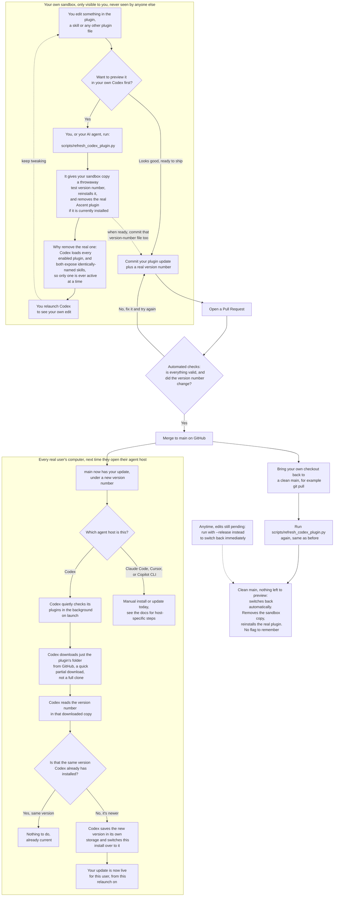

# Installing and updating Ascent

How Ascent is installed depends on the agent host. Codex can install it directly from GitHub, with no local checkout and no further action to stay current. Claude Code, Copilot CLI, and Cursor still install from a clean local checkout of the repository — keep that checkout in your normal project `repos/` directory, not in an agent host's managed plugin, cache, or skills directory, and reuse an existing checkout instead of cloning another copy.

## Install

### Codex (recommended)

```bash
codex plugin marketplace add Slalom/ascent
codex plugin add ascent@ascent
```

No local checkout is needed. Codex clones `plugins/ascent` from this repository on GitHub directly (a `git-subdir` marketplace source — see `.agents/plugins/marketplace.json`). Relaunch the Codex app after installation so the plugin skills are loaded.

#### How Codex picks up changes

For a Git-sourced plugin — the install above — Codex re-clones the source and
compares its version every time the app launches, automatically, with nothing
to run and nothing to configure. It does not look at file contents, only the
`version` field in `plugins/ascent/.codex-plugin/plugin.json`, so a change
reaches an installation only once it ships with a version bump (every change
under `plugins/ascent/` must include one; `scripts/check_plugin_version_bump.py`
enforces this on pull requests into `main`). Relaunch the app to pick up a
change — starting a new task is not enough.

This is confirmed against Codex's own source (`core-plugins/src/loader.rs`):
the same automatic, launch-time refresh that applies to a local-source plugin
also runs for a Git-sourced one, using a fresh clone each time rather than
reading a local path. Verified directly, end to end: a manual install, an
idempotent relaunch (no changes upstream, nothing reinstalled), and picking up
a real upstream version bump through nothing but a plain relaunch — no manual
install command involved.

### Other hosts, and local development

Claude Code, Copilot CLI, and Cursor install from a checkout, and so does
anyone editing the authoritative source. Get one first:

```bash
gh repo clone Slalom/ascent
cd ascent
```

Run the commands below for your agent host from the repository root.

#### Codex, from a local checkout

Register the local-source marketplace (`ascent-dev`, not the `ascent`
marketplace real end users install from):

```bash
codex plugin marketplace add ./.agents/plugins/marketplace.local.json
codex plugin add ascent@ascent-dev
```

While iterating, run:

```bash
python3 scripts/refresh_codex_plugin.py
```

On a feature branch, or with uncommitted changes, this gives the plugin a
new version and reinstalls `ascent@ascent-dev` from the local marketplace,
then reminds you to relaunch Codex. It also removes the real `ascent@ascent`
plugin if it is installed (quietly, so it is not an error when it already
is not): Codex loads every enabled plugin, and the real plugin and the
sandbox copy expose identically-named skills, so having both active at once
means whichever one gets used is not something to rely on. Commit the
version change together with your plugin changes: that new version is what
makes everyone else's installation — Git-sourced or local — pick them up.

Once your change is committed and merged, bring your checkout back to a
clean `main` (for example `git checkout main && git pull --ff-only`) and run
the same command again. On a clean `main` checkout there is no pending edit
to preview, so it pulls the latest release and switches back on its own:
removes `ascent@ascent-dev`, reinstalls the real `ascent@ascent` from its
own registered marketplace, and asks for a relaunch. Nothing else to run or
remember. It never leaves a local version edit behind either, so it is also
safe to run when someone asks Codex to "update Ascent" on a local-source
install; if an older version of the script already left such an edit, both
this command and the background job restore it and carry on.

To switch back immediately instead, with edits still pending:

```bash
python3 scripts/refresh_codex_plugin.py --release
```

#### Claude Code

```bash
claude plugin marketplace add .
claude plugin install ascent@ascent
```

If `claude plugin marketplace list` already includes `ascent`, skip the marketplace-add command. Start a new Claude Code session after installation.

#### GitHub Copilot CLI

```bash
copilot plugin marketplace add .
copilot plugin install ascent@ascent
```

If `copilot plugin marketplace list` already includes `ascent`, skip the marketplace-add command. Start a new Copilot CLI session after installation.

#### Cursor

For a personal setup, run the following command in Cursor and select Ascent:

```text
/add-plugin https://github.com/Slalom/ascent
```

For a team setup, import `https://github.com/Slalom/ascent` from **Dashboard > Settings > Plugins > Team Marketplaces**, then grant the appropriate access.

## Update

### Codex, Git-sourced install

Nothing to do. Relaunch the Codex app; it re-clones `plugins/ascent` and
compares versions on its own, every launch. See
[How Codex picks up changes](#how-codex-picks-up-changes) above.

### Codex, local-source install

A local-source install — a developer's own checkout, or an end-user install
from before the Git-sourced marketplace existed — does not get Codex's
automatic Git refresh, since there is no Git source to compare. Use one of
the paths below instead.

#### Automatically, with the background job

`ascent-initial-setup` offers to enable a daily background check the first time it
runs on a machine. If accepted, it registers a per-user scheduled job (a
macOS LaunchAgent, Windows Scheduled Task, or Linux crontab entry) that
fast-forwards the local `main` checkout from `origin/main` once a day. The
update takes effect the next time Codex is relaunched; there is no need to
relaunch every time the job runs, since most runs find nothing new and one
relaunch picks up the latest download. When an update is waiting, Ascent's
workspace skills say so at the start of their next run. They also speak up
when background updates are stuck — blocked by macOS privacy settings, or no
successful check in ten days — and say why in plain words. It never prompts and
never forces a change — it skips safely (logging why, to
`~/.codex/ascent-plugin-update.log`) whenever the checkout is on another
branch or has uncommitted changes. The log also notes when a pull changed
plugin files without a new version, since Codex will not load those
changes. Decline or accept the
question again at any time by rerunning `ascent-initial-setup`, or manage the job
directly:

```bash
python3 plugins/ascent/skills/ascent-initial-setup/scripts/manage-plugin-update-schedule.py --status
python3 plugins/ascent/skills/ascent-initial-setup/scripts/manage-plugin-update-schedule.py --install
python3 plugins/ascent/skills/ascent-initial-setup/scripts/manage-plugin-update-schedule.py --install --frequency weekly
python3 plugins/ascent/skills/ascent-initial-setup/scripts/manage-plugin-update-schedule.py --uninstall
```

`--install --frequency {daily,weekly}` also changes an already-installed
job's frequency in place — no need to uninstall first.

This only covers a local-source Codex install. Claude Code, Copilot CLI,
and Cursor still need the manual steps below.

#### Manually

Update the clean repository checkout, then load the update in your host:

```bash
git pull --ff-only

# Codex, local-source install: relaunch the Codex app. Nothing else is
# needed when the pull brought a new plugin version.

# Claude Code
claude plugin marketplace update ascent
claude plugin update ascent@ascent

# GitHub Copilot CLI
copilot plugin marketplace update ascent
copilot plugin update ascent
```

For the other hosts, start a new task or session after updating when the host does not reload plugin contents automatically. In Cursor, refresh the imported marketplace and update Ascent from the Plugins panel.

## The full picture

Everything above, end to end: an edit in your own sandbox, through commit
and merge, to how it reaches every real user automatically once Codex is
Git-sourced.


